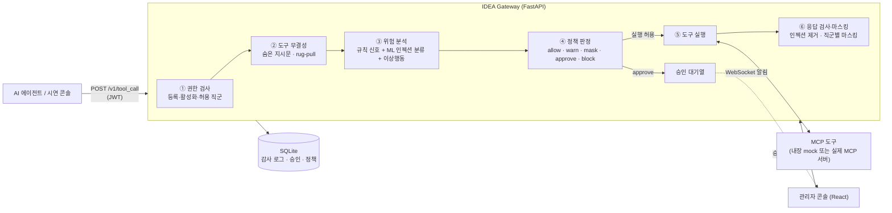

# 4CUS_P3G — 의료 AI 에이전트용 MCP 보안 게이트웨이 (IDEA Gateway)

> AI 에이전트가 병원 시스템의 도구(MCP Tool)를 호출할 때, 그 호출을 **중간에서 가로채 위험도를 평가하고**
> 허용 · 마스킹 · 사람 승인 · 차단 중 하나로 판정하는 보안 게이트웨이와 관리자 콘솔입니다.

> [!NOTE]
> 이 저장소의 **모든 환자 데이터는 합성(가짜) 데이터**입니다. 환자 이름은 무작위로 조합한 가상 이름이고,
> 주민등록번호·전화번호·진단명·예약 일정은 코드에서 규칙적으로 생성한 더미 값입니다
> ([`backend/app/mcp_tools/registry.py`](backend/app/mcp_tools/registry.py)). 실제 환자 정보는 사용하지 않았습니다.

---

## 목차
1. [개요](#1-개요)
2. [배경 및 동기](#2-배경-및-동기)
3. [아키텍처](#3-아키텍처)
4. [주요 기능](#4-주요-기능)
5. [기술 스택](#5-기술-스택)
6. [실행 방법](#6-실행-방법)
7. [결과 및 성과](#7-결과-및-성과)
8. [한계 및 향후 계획](#8-한계-및-향후-계획)

---

## 1. 개요

| 항목 | 내용 |
|---|---|
| 프로젝트명 | 4CUS_P3G (서비스명: IDEA Gateway) [작성자 확인 필요: 프로젝트명 "4CUS", "P3G"의 의미] |
| 형태 | 팀 프로젝트 [작성자 확인 필요: 소속 / 대회·수업명 / 진행 기간] |
| 한 줄 요약 | MCP 기반 의료 AI 에이전트의 도구 호출을 실시간으로 검사·통제하는 보안 게이트웨이 |
| 구성 | FastAPI 백엔드(게이트웨이 + REST/WebSocket API) · React 관리자 콘솔 |

에이전트가 `search_patient`, `get_medical_record`, `send_email` 같은 도구를 호출하면 요청은 곧바로 실행되지 않고
게이트웨이의 `POST /v1/tool_call` 을 거칩니다. 게이트웨이는

1. **누가** (JWT로 확인한 로그인 직군과 사용자),
2. **무엇을** (어떤 도구를, 어떤 인자로),
3. **어떤 맥락에서** (직전 10분간의 호출 이력, 평소 행동 패턴, 원래 요청 문장)

호출했는지를 종합해 위험 점수(0–100)를 매기고, 그 결과에 따라 실행 여부와 응답 노출 수준을 결정합니다.
모든 판정은 감사 로그로 남고, 관리자 콘솔에서 실시간으로 확인·승인할 수 있습니다.

## 2. 배경 및 동기

- LLM 에이전트가 **MCP(Model Context Protocol)** 로 외부 도구를 직접 호출하게 되면서, 에이전트가
  "사용자가 원하지 않은 행동"을 하는 경우를 막을 장치가 필요해졌습니다.
  - 정상 요청 뒤에 민감정보 조회와 외부 전송이 이어지는 **데이터 유출 흐름**
  - 사용자 입력이나 도구 응답에 섞여 들어온 **프롬프트 인젝션**
  - 도구 설명에 숨은 지시문을 넣거나 등록 후 설명을 바꿔치기하는 **툴 포이즈닝 / rug-pull**
- 의료 도메인은 진료기록·주민등록번호처럼 노출 시 피해가 큰 정보를 다루고, **직군과 담당 여부에 따라
  볼 수 있는 정보의 범위가 달라야** 합니다(예: 담당의는 원문, 비담당 의사는 비식별).
- 따라서 에이전트와 도구 사이에 **정책 기반 판정 + 직군별 마스킹 + 사람 승인(Human-in-the-loop)** 을 수행하는
  게이트웨이 계층을 두는 것을 목표로 했습니다.

[작성자 확인 필요: 프로젝트를 시작하게 된 구체적 계기나 참고한 사례·문헌이 있다면 추가]

## 3. 아키텍처



### 요청 처리 흐름 (`backend/app/api/tool_call.py`)

| 단계 | 내용 | 관련 코드 |
|---|---|---|
| ① 권한 검사 | 미등록 도구, 비활성 도구, 허용되지 않은 직군이면 즉시 차단(100점) | `api/tool_call.py`, `seed.py` |
| ② 도구 무결성 | 도구 설명의 숨은 지시문 탐지, 최초 등록 설명 대비 **문자 n-gram TF-IDF 코사인 유사도**가 0.80 미만이면 변조로 판단 | `core/tool_integrity.py` |
| ③ 위험 분석 | 아래 위험 신호 점수를 합산(최대 100) | `core/analyzers.py`, `core/anomaly.py`, `core/ml_classifier.py` |
| ④ 정책 판정 | 기본 임계값 **경고 30 / 승인 60 / 차단 80** (관리자 화면에서 변경 가능). 민감정보 조회가 허용·경고 구간이면 `mask`로 전환 | `core/policy.py`, `api/rules.py` |
| ⑤ 실행 | 실제 MCP 서버가 연결돼 있고 해당 도구가 있으면 위임, 없으면 내장 mock 도구로 실행 | `mcp_tools/registry.py`, `mcp_tools/mcp_client.py` |
| ⑥ 응답 처리 | 응답에서 인젝션 의심 문구 제거(감사 위험도 +45), 직군·담당 여부별 필드 마스킹 | `core/prompt_injection.py`, `core/masking.py` |

### 위험 신호와 점수 (`core/analyzers.py`)

| 신호 | 조건 | 점수 |
|---|---|---|
| `sensitive_read` | 진료기록 조회 | 25 |
| `external_send` | 외부 도메인으로 이메일 / CSV 반출 | 30 |
| `sensitive_then_send` | 민감정보 조회 이후 외부 전송 시도 | 40 |
| `purpose_mismatch` | 요청 목적(예약 확인)과 무관한 고위험 도구 호출 | 25 |
| `mass_access` | 최근 10분 내 진료기록 3회 이상 조회 | 35 |
| `prompt_injection` | 요청문·인자에서 정규식 패턴 탐지 | 45 |
| `ml_injection_judgment` | ML 분류기 확률 ≥ 0.6 | 확률 × 45 |
| `behavior_anomaly` | 오늘 민감정보 조회 건수의 z-score ≥ 2.0 (과거 3일 이상 이력 필요) | 30 |
| `fhir_sensitive_read` / `fhir_write` / `fhir_delete` | FHIR 민감 리소스 조회 / 생성·수정 / 삭제 | 25 / 20 / 50 |
| `fhir_mass_access` | FHIR 민감 리소스 3회 이상 조회 | 35 |
| `missing_required_arguments` | 필수 인자 누락 | 10 |

### 디렉터리 구조

```
4CUS_P3G/
├── backend/
│   ├── app/
│   │   ├── main.py              # FastAPI 진입점 (DB 초기화, 시드, MCP 연결)
│   │   ├── models.py            # SQLModel 테이블 (세션, 호출, 이벤트, 승인, 도구, 정책, 사용자)
│   │   ├── database.py
│   │   ├── seed.py, seed_users.py   # 기본 도구 목록 · 데모 계정
│   │   ├── api/                 # tool_call · approval(WebSocket) · auth · events · analytics · reports · rules · tools
│   │   ├── core/                # analyzers · policy · scorer · masking · prompt_injection
│   │   │                        # ml_classifier · anomaly · tool_integrity · auth(JWT)
│   │   └── mcp_tools/           # registry(mock 도구 + 합성 데이터) · mcp_client · sync
│   ├── scripts/                 # 합성 환자 목록 / 직군별 마스킹 정책 표 출력
│   ├── tests/test_smoke.py      # 통합 스모크 테스트
│   ├── requirements.txt
│   └── .env.example
└── frontend/
    └── src/
        ├── api.js               # 백엔드 호출 · 토큰 관리
        ├── components/          # Layout · Sidebar · RiskBadge
        └── pages/               # Login · Dashboard · Console · Approvals · Logs · Analytics · Tools · Policy
```

## 4. 주요 기능

### 게이트웨이 (백엔드)
- **JWT 로그인 기반 신원 확인** — 요청 본문이 아닌 토큰의 직군·사용자 ID로만 판정 (PBKDF2 비밀번호 해시)
- **9개 직군별 필드 마스킹** — 의사 · 간호사 · 약사 · 원무 · 보험심사 · 보안 담당 · 전산 관리자 · 실습생 · 병원 행정.
  필드(이름, 주민번호, 전화번호, 진단명, 소견, 예약, 환자ID)마다 `원문 / 부분 마스킹 / 비식별 / 접근불가` 등급을 지정하고,
  의사·간호사는 **담당 환자인지 여부**에 따라 등급이 달라집니다 (`core/masking.py`).
- **프롬프트 인젝션 2중 탐지** — 한국어·영어 정규식 + 제로폭 문자 탐지, 그리고 문자 n-gram TF-IDF + 로지스틱 회귀 분류기.
  요청뿐 아니라 **도구 실행 결과**에 섞인 인젝션 문구도 탐지·제거합니다.
- **툴 포이즈닝 / rug-pull 탐지** — 도구 설명의 숨은 지시문 검사, 최초 등록본 대비 의미 유사도 비교 (사소한 수정은 허용)
- **행동 이상탐지** — 사용자별 일일 민감정보 조회량의 z-score
- **사람 승인(Human-in-the-loop)** — 승인 구간 요청은 대기열에 들어가고 WebSocket으로 관리자에게 즉시 알림, 5분이 지나면 자동 만료
- **감사 로그 & 리포트** — 모든 판정과 사유를 저장, CSV / PDF 보안 리포트 다운로드
- **실제 MCP 서버 연동(선택)** — stdio / Streamable HTTP 방식으로 외부 MCP 서버(예: FHIR MCP 서버)에 연결.
  새로 발견된 도구는 **비활성 + system_admin 전용**으로 보수적으로 등록되고, 관리자가 검토 후 활성화합니다.

### 관리자 콘솔 (프론트엔드)
| 화면 | 내용 |
|---|---|
| 대시보드 | 총 이벤트, 차단·마스킹·승인 대기 수, 판정 분포, 도구 Top 5, 최근 이벤트 |
| 시연 콘솔 | 정상 / 외부 전송 / 대량 조회 / 담당·비담당 / 프롬프트 인젝션 / FHIR 검색 시나리오 실행, 직접 도구 호출 입력 |
| 승인 큐 | 승인 대기 요청을 실시간으로 받아 승인·거부 |
| 감사 로그 | 이벤트별 위험 점수, 판정, 탐지 사유, 세션 내 도구 호출 흐름 |
| 분석·리포트 | 통계 및 CSV / PDF 리포트 다운로드 |
| 도구 관리 | 도구 활성화, 허용 직군 설정 (관리자 전용) |
| 정책 설정 | 경고 / 승인 / 차단 임계값 조정 (관리자 전용) |

[작성자 확인 필요: 화면 스크린샷 또는 시연 GIF 추가 권장 — 예: `docs/images/dashboard.png`]

## 5. 기술 스택

| 구분 | 사용 기술 |
|---|---|
| Backend | Python 3.10+, FastAPI, Uvicorn, SQLModel(SQLAlchemy) + SQLite |
| 보안 / 인증 | PyJWT(HS256), PBKDF2-HMAC-SHA256 |
| ML | scikit-learn (TF-IDF, Logistic Regression, cosine similarity) |
| 에이전트 연동 | MCP Python SDK (stdio, Streamable HTTP) |
| 리포트 | ReportLab (PDF), csv |
| Frontend | React 18, Vite 5, React Router 6, lucide-react |
| 실시간 | WebSocket (`/ws/approvals`) |

## 6. 실행 방법

### 사전 준비
- Python 3.10 이상
- Node.js 18 이상

### 1) 백엔드
```bash
cd backend
python -m venv .venv
# Windows: .venv\Scripts\activate   |   macOS/Linux: source .venv/bin/activate
pip install -r requirements.txt

# (선택) 환경변수 설정 — 필요할 때만
cp .env.example .env    # Windows: copy .env.example .env

uvicorn app.main:app --reload
```
- API 문서(Swagger): <http://127.0.0.1:8000/docs>
- 처음 실행하면 `backend/idea_gateway.db`(SQLite)가 만들어지고, 기본 도구 목록·데모 계정·정책 임계값이 자동으로 등록됩니다.
- `.env`에 MCP 설정이 없으면 **내장 mock 도구와 합성 데이터만으로 동작**합니다.

### 2) 프론트엔드
```bash
cd frontend
npm install
npm run dev
```
- 브라우저에서 <http://localhost:5173> 접속 (백엔드 주소는 `frontend/src/api.js`의 `API_BASE`)

### 3) 데모 계정
모든 계정의 비밀번호는 `pass1234` 입니다. **로컬 시연용 계정**이며 실제 환경에서 사용하면 안 됩니다.

| 아이디 | 직군 | 비고 |
|---|---|---|
| `doctor_kim` / `doctor_park` | doctor | 각각 P1001 / P1002 담당의 |
| `nurse_lee` / `nurse_choi` | nurse | 각각 P1001 / P1002 담당간호사 |
| `pharm01` | pharmacist | |
| `admin_staff01` | admin_staff | |
| `insurance01` | insurance_reviewer | |
| `security01` | security_officer | |
| `sysadmin01` | system_admin | 관리자 (승인 처리, 도구·정책 변경 가능) |
| `hospadmin01` | hospital_admin | 관리자 |
| `intern01` | intern | |

### 4) 테스트 및 보조 스크립트 (`backend` 폴더에서)
```bash
python -m tests.test_smoke              # 통합 스모크 테스트
python -m scripts.list_patients         # 합성 환자 데이터 표 출력
python -m scripts.list_masking_policy   # 직군별 마스킹 정책 표 출력
```
> 스모크 테스트는 현재 폴더의 `idea_gateway.db`에 테스트 기록을 남깁니다. 깨끗한 상태로 보려면 실행 전에 이 파일을 지우세요.

### 5) (선택) 실제 MCP 서버 연동
`backend/.env`에 아래 값을 설정하면 서버 시작 시 외부 MCP 서버에 연결하고, 그 서버의 도구를 위임 실행합니다.
```env
MCP_TRANSPORT=stdio
MCP_SERVER_COMMAND=uvx
MCP_SERVER_ARGS=fhir-mcp-server --transport stdio
# http 방식이면: MCP_TRANSPORT=http, MCP_SERVER_URL=http://<host>:<port>/mcp
```
[작성자 확인 필요: 시연에 사용한 FHIR 서버(공개 테스트 서버 등)와 그 서버의 데이터가 합성 데이터인지 여부]

## 7. 결과 및 성과

**코드로 확인 가능한 결과**

`backend/tests/test_smoke.py`가 아래 항목을 하나의 흐름으로 검증하며, 현재 코드 기준으로 **전 항목 통과**합니다.
- 담당 / 비담당 환자에 따른 마스킹 등급 차이 (의사, 간호사)
- 직군별 마스킹 (약사, 보안 담당자, 미등록 직군 기본값)
- 권한 없는 직군의 도구 호출 차단 (예: 실습생의 이메일 발송)
- 요청·인자의 프롬프트 인젝션 탐지 (정규식 + ML)
- 필수 인자 누락 처리
- 툴 포이즈닝: 의미적 변조 차단, 사소한 수정은 허용(오탐 방지), 숨은 지시문 차단
- 행동 이상탐지 (z-score)
- 관리자 API 인증 (미인증 401 / 비관리자 403 / 관리자 200)

**정량 성과**
- 탐지 성능(정탐률·오탐률 등): [작성자 확인 필요: 별도 평가 데이터셋으로 측정한 수치가 있다면 기재]
  - 참고: 현재 ML 인젝션 분류기는 코드에 내장된 소량의 예문(정상 30개, 공격 30개)으로 학습하며, 별도 검증 세트 평가는 저장소에 포함되어 있지 않습니다.
- 게이트웨이 처리 지연 시간: [작성자 확인 필요]
- 수상 / 발표 / 시연 이력: [작성자 확인 필요]

## 8. 한계 및 향후 계획

**현재 한계 (시연용 프로토타입 기준)**
- 데모 계정 비밀번호가 고정(`pass1234`)되어 있고, JWT 서명 키는 `.env`의 `JWT_SECRET`이 없으면 개발용 기본값을 사용합니다.
- CORS가 모든 출처(`*`)를 허용합니다.
- 일부 API(`/events`, `/analytics/summary`, `/approvals` 조회, `/tools`·`/rules` 조회, `/reports/*`, `/ws/approvals`)는 인증 없이 호출할 수 있습니다.
  상태를 바꾸는 API(도구 호출, 승인 처리, 도구·정책 변경)는 인증·관리자 권한을 요구합니다.
- ML 분류기 학습 데이터가 작고, 서버를 시작할 때마다 메모리에서 학습합니다.
- 위험 신호 점수와 임계값은 휴리스틱으로 정한 값입니다.

**향후 계획**
- [ ] 조회 API 전반에 인증·인가 적용, CORS 허용 출처 제한, 운영용 비밀값 관리
- [ ] 인젝션 탐지용 평가 데이터셋 구축 및 정량 평가 (정밀도 / 재현율)
- [ ] 위험 점수 가중치를 실제 로그 기반으로 보정
- [ ] SQLite → 운영용 DB 전환, 감사 로그 무결성(해시 체인 등) 강화
- [ ] 실제 EMR / FHIR 환경과의 연동 검증

[작성자 확인 필요: 위 계획 중 실제로 의도했던 항목만 남기고 추가할 내용 보완]

<!--
## 팀 구성 및 역할 (작성 예정)
-->
